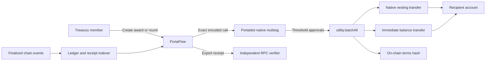

# PortaFlow

**Native treasury operations and contributor funding for Portaldot teams.**

PortaFlow helps ecosystem foundations, DAOs, grant programs, and development teams distribute contributor funding through shared approvals, immediate payments, and native vesting schedules. Teams can fund a single award or a payout round of up to 25 payments through one atomic multisig proposal.

Instead of coordinating payouts through spreadsheets, private messages, and a wallet controlled by one person, teams can run the full funding flow from one workspace while Portaldot's native multisig system keeps the treasury under shared control.

## The problem

Contributor payments are usually assembled from disconnected tools. A spreadsheet defines the amounts, messages record informal approvals, and one operator submits the transfers. This makes it difficult for signers to verify the exact terms, for recipients to understand their release schedule, and for a program to reconcile decisions with finalized transactions.

PortaFlow turns that process into a transparent Portaldot-native workflow:

- treasury control is shared by 2–5 independent native accounts;
- every signer reviews the exact recipient, amount, payment split, and schedule;
- immediate payments and funded vesting execute atomically across the complete payout round;
- release progress follows finalized Portaldot blocks; and
- a treasury ledger, recipient portal, and independently verified funding receipts connect decisions to their on-chain results.

## How it works

1. **Create a shared treasury.** Choose 2–5 Portaldot accounts and an approval threshold. PortaFlow derives their native multisig address.
2. **Fund the treasury.** Transfer testnet tPOT into that address. The designated signers retain control through their own wallets.
3. **Prepare a payout round or individual award.** Define recipients, amounts, immediate percentages, vesting schedules, and optional public work references. Rounds accept up to 25 payments, entered manually or imported from CSV. A payment can also be 100% immediate, with no vesting schedule.
4. **Approve from separate wallets.** Each signer reviews and signs the same encoded call. The approval queue shows pending proposals. Proposals live in Portaldot's native multisig pallet, so signers can approve from different computers.
5. **Fund atomically.** The final approval executes all transfers, vesting schedules, and the terms commitment in the proposal. If a payment fails, the entire funding batch rolls back.
6. **Reconcile and unlock.** The treasury ledger records incoming and outgoing transfers. Recipients can use **My funds** to see funding across workspaces, inspect finalized vesting progress, and request an unlock. A helper can also submit the permissionless vesting update.
7. **Export and verify proof.** Download an award or round's JSON receipt, then use **Verify receipt** or the standalone CLI to check the funding against Portaldot RPC data independently of the application database.

## Atomic funding call

For an individual award, PortaFlow constructs one `utility.batchAll` call containing:

1. `vesting.vestedTransfer` for any vested allocation;
2. `balances.transferKeepAlive` for any immediate allocation; and
3. `system.remarkWithEvent` containing the award ID and a BLAKE2 hash of its canonical terms.

For a payout round, one flat `utility.batchAll` includes every payment's applicable transfers, followed by one commitment to the complete round manifest. Signers approve one call covering the exact recipients, amounts, schedules, treasury policy, and terms hash.

If an operation fails, the complete batch fails. A successful outer extrinsic is not treated as proof of successful payment: PortaFlow also checks the inner multisig dispatch result before marking an award or round as funded. Transaction fees can still be charged when execution fails.

The entire award reaches the recipient at funding time. Its immediate portion is transferable, while the vested portion is locked by Portaldot until the block schedule permits its use.



## Key features

- Portaldot native wallet connection
- Multiple independent treasury workspaces
- Configurable multisig thresholds with 2–5 signers
- Immediate and vested tPOT payment splits
- Atomic payout rounds with up to 25 payments, plus individual award funding
- Fully immediate payments without a vesting schedule
- CSV round import and individual draft import with validation
- Approval queue for draft and pending proposals
- Transaction review before every wallet signature
- Treasury ledger with incoming/outgoing transfers and explicit history coverage
- Separate views of spendable balance, proposed spending, drafts, funded totals, signer fees, and pending multisig deposits
- Recipient portal aggregating funded awards and round payments across workspaces
- Block-based release progress using finalized chain state
- Recipient and third-party vesting unlocks
- Finalized approval, funding, cancellation, failure, and unlock history
- Downloadable award and round JSON receipts
- Independent funding verification through the UI, API, and CLI
- Genesis hash, runtime version, and call-shape checks before signing
- Checkpointed history synchronization that resumes after interrupted or failed scans
- Responsive treasury workbench with persistent light and dark themes

## Ledger and recipient views

The **Treasury ledger** indexes native transfers into and out of each treasury. It separates current on-chain spendable balance from draft, pending, and completed funding totals. Signer transaction fees and pending multisig deposits are shown separately from treasury payments.

History coverage is explicit: the ledger reports its starting block and synchronization progress. It should not be interpreted as a complete account history before that starting block.

The **My funds** portal collects a recipient's funded individual awards and round payments across PortaFlow workspaces. It shows immediate and vested allocations alongside the recipient's current native balance and unlock eligibility. Release progress is based on finalized blocks; updating the transferable balance requires a separate `vesting.vestOther` transaction. The account submitting that transaction pays its network fee.

## Independent receipt verification

Export a funded award or round's JSON receipt and upload it in **Verify receipt**, or run:

```bash
npm run verify:receipt -- path/to/receipt.json
```

The verifier uses the receipt and the pinned Portaldot RPC, without consulting PortaFlow's database. It reconstructs the treasury address and exact funding call, checks the canonical terms hash, confirms the funding block is finalized, and checks successful inner multisig execution, batch completion, the on-chain terms commitment, and exact recipient transfers.

It supports individual award receipts (version 1) and payout round receipts (version 2). Results are `verified`, `invalid`, or `unavailable`; missing historical RPC data produces `unavailable` rather than proving the payment invalid. CLI exit codes are `0`, `1`, and `2`, respectively. The API exposes the same verifier at `POST /api/verify`.

## Why Portaldot is essential

PortaFlow does not place treasury funds in a custom custody contract. Its core guarantees come directly from Portaldot V3 runtime capabilities.

| Portaldot capability | PortaFlow usage |
| --- | --- |
| `pallet-multisig` | Shared treasury custody and threshold approvals |
| `pallet-utility` | Atomic execution of the complete funding plan |
| `pallet-balances` | Treasury funding and immediate tPOT payments |
| `pallet-vesting` | Native block-based contributor vesting and unlocks |
| `pallet-system` | On-chain commitment to hashed award or round terms |
| Finalized chain state | Balances, release progress, and verified receipts |
| Native AccountId32 wallets | Treasury signers and contributor recipients |

Wallet private keys never enter PortaFlow. Signatures are requested through the user's browser extension, and the browser decodes each server-prepared transaction to confirm that it matches the terms shown in the review screen.

## Portaldot testnet

| Setting | Value |
| --- | --- |
| Network | Portaldot V3 Testnet |
| Native WebSocket RPC | `wss://test-node-v3.portaldot.dev` |
| Native token | tPOT |
| Token decimals | 14 |
| SS58 prefix | 42 |
| Testnet block explorer | [scanner-testnet-v3.portaldot.dev](https://scanner-testnet-v3.portaldot.dev/) |

The application uses real testnet accounts, balances, multisig proposals, vesting schedules, finalized blocks, events, and network fees. Demo figures are not simulated.

## Technical architecture

### Frontend

- React 19 and TypeScript
- Vite
- Tailwind CSS, daisyUI, and Radix-based UI primitives
- Lucide icons
- `@polkadot/api` wallet and transaction integration

### Backend and persistence

- Node.js and Fastify
- MongoDB Atlas for hosted persistence
- SQLite for local development
- Signed wallet challenges and expiring sessions
- Finalized Portaldot event indexing with persisted synchronization checkpoints
- Persistent payout rounds, treasury ledger entries, and transaction receipts
- Database-independent receipt verification

### Source layout

| Location | Responsibility |
| --- | --- |
| `web/App.tsx` | Treasury workspace, navigation, wallet connection, and transaction review |
| `web/Operations.tsx` | Payout round operations, ledger, recipient portal, and receipt verifier |
| `shared/calls.ts` | Canonical terms, hashes, and native funding call construction |
| `server/app.ts` | Authenticated API and workspace operations |
| `server/chain.ts` | Chain checks, transaction planning, finalized indexing, and unlocks |
| `server/verify.ts` | Independent receipt verification against RPC data |
| `server/store.ts`, `server/mongo-store.ts` | SQLite and MongoDB persistence |
| `scripts/verify-receipt.ts` | Standalone receipt verification CLI |

### Hosting

- Vercel frontend and Node.js API function
- MongoDB Atlas database
- Portaldot V3 Testnet

In serverless mode, finalized transactions are queued by the browser and verified against the canonical chain by the API before receipts are stored. MongoDB leases serialize indexing between warm function instances. Hosted synchronization runs during requests; a serverless function is not a continuously running indexer.

Approval planning catches up finalized history before preparing a transaction. Scans save progress after completed windows and resume from that checkpoint after interruptions. If catch-up exceeds the request budget, the API returns a retryable response instead of preparing a proposal from incomplete history. Full blocks are downloaded only when events are relevant to tracked accounts or proposals.

## Run locally

Requires Node.js 22.13 or newer.

```bash
git clone https://github.com/sneaxhuh/portaflow.git
cd portaflow
npm ci
cp .env.example .env
npm run build
node --env-file=.env --import tsx server/index.ts
```

Open [http://127.0.0.1:8787](http://127.0.0.1:8787).

For frontend and API development, use separate terminals:

```bash
node --env-file=.env --import tsx --watch server/index.ts
npm run dev:web
```

Local development uses SQLite by default. To use MongoDB, set `MONGODB_URI` in `.env`; never commit database credentials. The commands above explicitly load `.env` through Node's `--env-file` option. Hosted deployments can supply environment variables directly.

## Environment variables

| Variable | Purpose | Default |
| --- | --- | --- |
| `PORT` | API and production server port | `8787` |
| `PORTAFLOW_HOST` | Local bind address | `127.0.0.1` |
| `PORTAFLOW_RPC` | Portaldot native WebSocket endpoint | Portaldot V3 testnet |
| `PORTAFLOW_DB` | Local SQLite database path | `.portaflow/portaflow.sqlite` |
| `MONGODB_URI` | MongoDB Atlas connection string | Unset |
| `MONGODB_DB` | MongoDB database name | `portaflow` |
| `PORTAFLOW_ORIGIN` | Exact public origin for custom hosting | Auto-detected where supported |

An existing local SQLite workspace can be imported into Atlas once with:

```bash
node --env-file=.env --import tsx scripts/migrate-atlas.ts
```

The migration copies treasuries, awards, payout rounds, receipts, ledger entries, and indexing coverage/cursors. Existing workspace records are preserved, and login sessions are excluded. Set `MONGODB_URI` in `.env` before running the command above.

## Current scope and limits

- Portaldot V3 testnet and native tPOT payments; there is no cross-chain bridge or custom custody contract in this project.
- Treasuries have 2–5 signers. Rounds contain at most 25 payments and must also fit runtime transaction weight, call-size, balance, and recipient vesting limits.
- Native vesting funds reach the recipient when funding executes. The sender cannot revoke a funded schedule; cancellation applies to an outstanding multisig proposal.
- Schedules follow block numbers. Day-based estimates are approximate, and reaching an unlock point does not automatically submit a transaction.
- Signers need funds for their own network fees and applicable multisig deposits, separately from the treasury's payout balance.
- Receipt verification depends on RPC access to the required finalized historical blocks, metadata, and events.

## License

MIT. Third-party dependencies retain their respective licenses.
