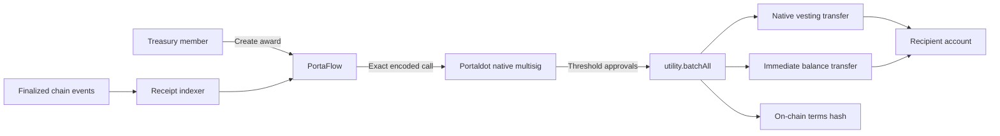

# PortaFlow

**Native treasury operations and contributor funding for Portaldot teams.**

PortaFlow helps ecosystem foundations, DAOs, grant programs, and development teams distribute contributor funding through shared approvals, immediate payments, and native vesting schedules.

Instead of coordinating payouts through spreadsheets, private messages, and a wallet controlled by one person, teams can run the full funding flow from one workspace while Portaldot's native multisig system keeps the treasury under shared control.

## The problem

Contributor payments are usually assembled from disconnected tools. A spreadsheet defines the amounts, messages record informal approvals, and one operator submits the transfers. This makes it difficult for signers to verify the exact terms, for recipients to understand their release schedule, and for a program to reconcile decisions with finalized transactions.

PortaFlow turns that process into a transparent Portaldot-native workflow:

- treasury control is shared by 2–5 independent native accounts;
- every signer reviews the exact recipient, amount, payment split, and schedule;
- immediate payment and funded vesting execute atomically;
- release progress follows finalized Portaldot blocks; and
- approvals, funding, failures, cancellations, and unlocks produce verifiable receipts.

## How it works

1. **Create a shared treasury.** Choose 2–5 Portaldot accounts and an approval threshold. PortaFlow derives their native multisig address.
2. **Fund the treasury.** Transfer testnet tPOT into that address. The designated signers retain control through their own wallets.
3. **Prepare awards.** Define a recipient, total amount, immediate percentage, vesting schedule, and optional public work reference. Teams can also import as many as 25 drafts from CSV.
4. **Approve from separate wallets.** Each signer reviews and signs the same encoded call. The pending proposal lives in Portaldot's native multisig pallet, so signers can approve from different computers.
5. **Fund atomically.** The final approval executes the immediate transfer, native vesting schedule, and terms commitment as one transaction.
6. **Track and unlock.** PortaFlow reads finalized chain state to show vesting progress. The recipient or a helper can submit the permissionless vesting update.
7. **Export proof.** Each award has a downloadable JSON receipt with its terms, treasury policy, transactions, blocks, signers, events, and fees.

## Atomic funding call

For each award, PortaFlow constructs one `utility.batchAll` call containing:

1. `vesting.vestedTransfer` for the vested allocation;
2. `balances.transferKeepAlive` for any immediate allocation; and
3. `system.remarkWithEvent` containing the award ID and a BLAKE2 hash of its canonical terms.

If an operation fails, the complete batch fails. A successful outer extrinsic is not treated as proof of successful payment: PortaFlow also checks the inner multisig dispatch result before marking an award as funded.

The entire award reaches the recipient at funding time. Its immediate portion is transferable, while the vested portion is locked by Portaldot until the block schedule permits its use.



## Key features

- Portaldot native wallet connection
- Multiple independent treasury workspaces
- Configurable multisig thresholds with 2–5 signers
- Immediate and vested tPOT payment splits
- Atomic award funding
- CSV draft import with validation
- Transaction review before every wallet signature
- Treasury, recipient, and spendable-balance views
- Block-based release progress using finalized chain state
- Recipient and third-party vesting unlocks
- Finalized approval, funding, cancellation, failure, and unlock history
- Downloadable chain-verified JSON receipts
- Genesis hash, runtime version, and call-shape checks before signing
- Responsive desktop and mobile interface

## Why Portaldot is essential

PortaFlow does not place treasury funds in a custom custody contract. Its core guarantees come directly from Portaldot V3 runtime capabilities.

| Portaldot capability | PortaFlow usage |
| --- | --- |
| `pallet-multisig` | Shared treasury custody and threshold approvals |
| `pallet-utility` | Atomic execution of the complete funding plan |
| `pallet-balances` | Treasury funding and immediate tPOT payments |
| `pallet-vesting` | Native block-based contributor vesting and unlocks |
| `pallet-system` | On-chain commitment to hashed award terms |
| Finalized chain state | Balances, release progress, and verified receipts |
| Native AccountId32 wallets | Treasury signers and contributor recipients |

Wallet private keys never enter PortaFlow. Signatures are requested through the user's browser extension, and the browser decodes each server-prepared transaction to confirm that it matches the terms shown in the review screen.

## Portaldot testnet

| Setting | Value |
| --- | --- |
| Network | Portaldot V3 Testnet |
| Native WebSocket RPC | `wss://test-node-v3.portaldot.dev` |
| Native token | tPOT |
| Token decimals | 14 |
| SS58 prefix | 42 |
| Node console | [node-console.portaldot.dev](https://node-console.portaldot.dev/) |

The application uses real testnet accounts, balances, multisig proposals, vesting schedules, finalized blocks, events, and network fees. Demo figures are not simulated.

## Technical architecture

### Frontend

- React 19 and TypeScript
- Vite
- Tailwind CSS and daisyUI
- Lucide icons
- `@polkadot/api` wallet and transaction integration

### Backend and persistence

- Node.js and Fastify
- MongoDB Atlas for hosted persistence
- SQLite for local development
- Signed wallet challenges and expiring sessions
- Finalized Portaldot event indexing

### Hosting

- Vercel frontend and Node.js API function
- MongoDB Atlas database
- Portaldot V3 Testnet

In serverless mode, finalized transactions are queued by the browser and verified against the canonical chain by the API before receipts are stored. MongoDB leases serialize indexing between warm function instances.

## Run locally

Requires Node.js 22.13 or newer.

```bash
git clone https://github.com/sneaxhuh/portaflow.git
cd portaflow
npm ci
cp .env.example .env
npm run build
npm start
```

Open [http://127.0.0.1:8787](http://127.0.0.1:8787).

For frontend and API development, use separate terminals:

```bash
npm run dev
npm run dev:web
```

Local development uses SQLite by default. To use MongoDB, set `MONGODB_URI` in `.env`; never commit database credentials.

## Environment variables

| Variable | Purpose | Default |
| --- | --- | --- |
| `PORT` | API and production server port | `8787` |
| `PORTAFLOW_HOST` | Local bind address | `127.0.0.1` |
| `PORTAFLOW_RPC` | Portaldot native WebSocket endpoint | Portaldot V3 testnet |
| `PORTAFLOW_DB` | Local SQLite database path | `.portaflow/portaflow.sqlite` |
| `MONGODB_URI` | MongoDB Atlas connection string | Unset |
| `MONGODB_DB` | MongoDB database name | `portaflow` |
| `PORTAFLOW_ORIGIN` | Exact public origin for custom hosting | Auto-detected where supported |

An existing local SQLite workspace can be imported into Atlas once with:

```bash
npm run migrate:atlas
```

The migration copies treasuries, awards, receipts, and indexing cursors. It does not copy login sessions or overwrite existing records.


## License

MIT. Third-party dependencies retain their respective licenses.
